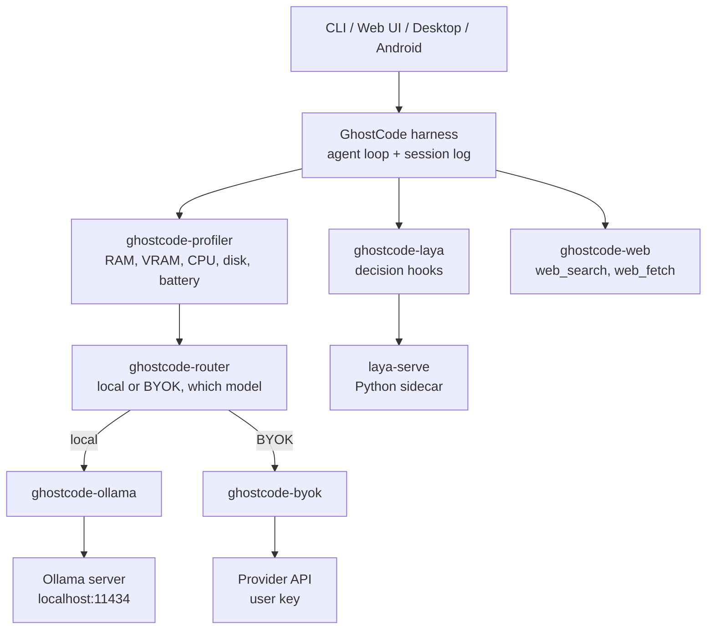
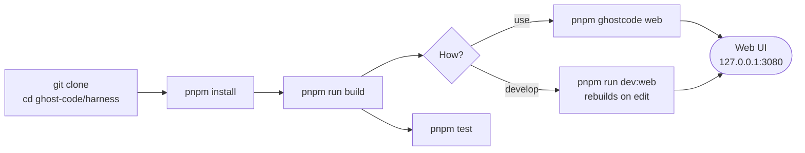

# GhostCode

An offline-first AI coding agent for laptops and phones.

GhostCode runs open models on the hardware you already own. It works with no
network, and your code stays on your machine. When the device is too small for
a local model, it switches to your own API key (BYOK).

- CLI: `ghostcode` (short alias `ghost`)
- Home directory: `~/.ghostcode` (env `GHOSTCODE_HOME`)
- Base: fork of [DeepSeek Harness](https://github.com/deepseek-ai/deepseek-harness) (MIT). GhostCode is not affiliated with or endorsed by DeepSeek.
- Local runtime: [Ollama](https://github.com/ollama/ollama) / [llama.cpp](https://github.com/ggml-org/llama.cpp)
- Decision layer: [Laya](https://huggingface.co/convaiinnovations/laya) (Apache 2.0)

## Architecture



The GhostCode plugins above are planned and do not exist yet. See
`docs/ARCHITECTURE.md` for the full system diagram, the router decision flow,
one agent turn with Laya, and the phase dependencies.

## How to run

### Prerequisites

- Node.js 24.9.0 or newer (`node -v`)
- pnpm 11.28.5 (`npm install -g pnpm@11.28.5`, then `pnpm -v`)
- Ollama, for local models later (`ollama --version`). The Ollama adapter is
  not built yet, so the harness does not use it today.

### Steps

```powershell
git clone https://github.com/nevil06/ghost-code.git
cd ghost-code\harness
pnpm install
pnpm run build
pnpm ghostcode web
```

`pnpm ghostcode web` starts the Web UI at `http://127.0.0.1:3080` and opens it
in your browser. Pass `--no-open` to start the server without a browser. For
live rebuilds while editing, run `pnpm run dev:web` instead. Read
`harness/SAFETY.md` before running.



## Layout

```text
ghostcode/
  README.md                     this file
  docs/
    ARCHITECTURE.md             Mermaid diagrams of the system and the plan
    IMPLEMENTATION_PLAN.md      phases, owners, tasks, acceptance criteria
    research/
      R1-ollama-model-download.md   track: how Ollama finds, downloads, stores models
      R2-ollama-runtime.md          track: how Ollama runs models, how GhostCode calls them
      R3-laya-integration.md        track: how Laya plugs into the agent loop
      hardware.md                   team test devices
  harness/                      the forked and rebranded harness
```

Start with `docs/IMPLEMENTATION_PLAN.md`.

Note: the AfterHours pitch deck calls this project "EdgeForge". Rename the deck
title to GhostCode before submission, or keep EdgeForge as the pitch name.
