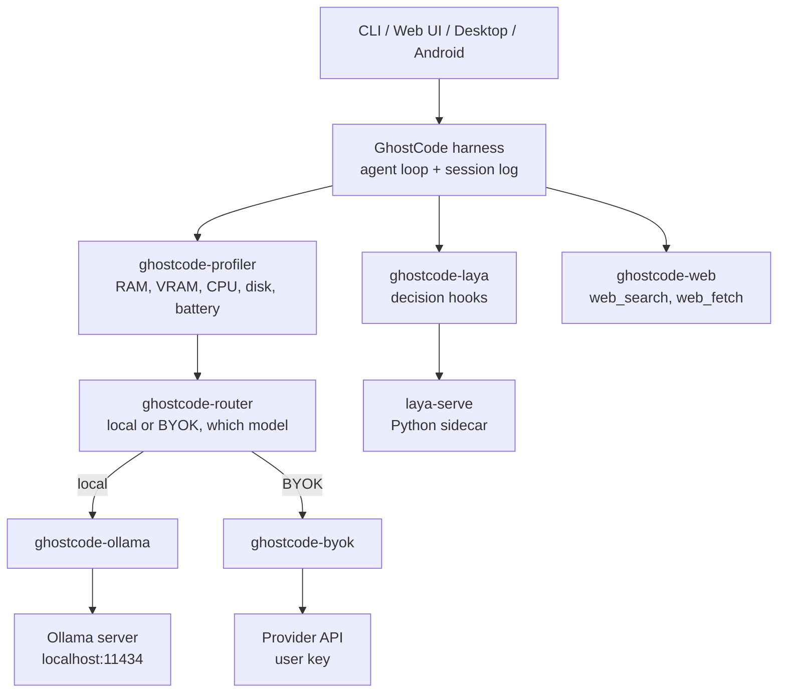

# GhostCode

An offline-first AI coding agent for laptops and phones.

GhostCode runs open models on the hardware you already own. It works with no
network, and your code stays on your machine. When the device is too small for
a local model, it switches to your own API key (BYOK).

- CLI: `ghostcode` (short alias `ghost`)
- Home directory: `~/.ghostcode` (env `GHOSTCODE_HOME`)
- Base: fork of [DeepSeek Harness](https://github.com/deepseek-ai/deepseek-harness) (MIT). GhostCode is not affiliated with or endorsed by DeepSeek.
- Local runtime: [Ollama](https://github.com/ollama/ollama) / [llama.cpp](https://github.com/ggml-org/llama.cpp)
- Decision layer: [Laya](https://huggingface.co/convaiinnovations/laya) (Apache 2.0)
- Team: Cozy Bears (Harsha N, Naren V, Mithun Gowda B, Nevil Anson Dsouza)

## Status

GhostCode is in developer preview. The fork is rebranded and runs, but the
GhostCode features are still planned: `harness/packages/ghostcode/` does not
exist yet. Read [`harness/SAFETY.md`](harness/SAFETY.md) before running it.

What works today comes from the upstream harness:

| Area | What the harness ships | Packages |
|---|---|---|
| Surfaces | CLI, Web UI, Electron desktop app, JSON-RPC SDK, Agent Client Protocol server | `apps/*`, `packages/sdk`, `packages/acp` |
| Models | DeepSeek adapter, and a `pi-ai` adapter for OpenAI-compatible gateways and self-hosted servers | `packages/llm/*` |
| Tools | File read/edit and search, shell, persistent terminal, LSP, MCP servers, subagents, todo, plan, workflow, background jobs | `packages/fs`, `shell`, `terminal`, `lsp`, `mcp`, `subagent`, ... |
| Web | `web_search` (Exa, Perplexity, DeepSeek) and `web_fetch` (plain HTTP or DeepSeek) | `packages/web/*` |
| Safety | Approval prompts, permission presets, command sandbox for Linux, macOS and Windows (Windows uses ACLs and gives partial confinement) | `packages/interaction`, `packages/sandbox` |
| Sessions | Durable session log, compaction, full-text session search | `packages/session`, `compaction`, `session-query` |

The `pi-ai` adapter may already reach Ollama's OpenAI-compatible endpoint at
`http://localhost:11434/v1`. This is untested. Checking it is research question
7 in [R2](docs/research/R2-ollama-runtime.md).

## Architecture

Every part of the harness is a [Cordis](harness/docs/cordis-primer.md) plugin,
including the agent loop, the model adapters and the tool registry. GhostCode
adds its features as plugins beside them and avoids editing `packages/core`, so
upstream merges stay cheap.



All `ghostcode-*` boxes above are planned. [`docs/ARCHITECTURE.md`](docs/ARCHITECTURE.md)
has the full system diagram, the router decision flow, one agent turn with Laya,
and the phase dependencies.

## How to run

### Prerequisites

- Node.js 24.9 or newer (`node -v`)
- pnpm 11.28.5 through Corepack: run `corepack enable`, then `pnpm -v`
- Git 2.26 or newer
- Optional: a model API key (for example DeepSeek) so the agent has a model to call
- Later: Ollama for local models (`ollama --version`)

On Windows, keep the checkout, `node_modules` and the toolchain in the same
environment: all native Windows or all inside WSL 2.

### Steps

```powershell
git clone https://github.com/nevil06/ghost-code.git
cd ghost-code\harness
pnpm install
pnpm run build
pnpm ghostcode web
```

`pnpm ghostcode web` starts the Web UI at `http://127.0.0.1:3080` and opens it
in your browser. Pass `--no-open` to start the server without a browser.

| Task | Command (from `harness/`) |
|---|---|
| Web UI with live rebuilds | `pnpm run dev:web` |
| Desktop app (Electron) | `pnpm run dev:desktop` |
| Tests | `pnpm test` |
| Lint / typecheck | `pnpm run lint` / `pnpm run typecheck` |
| Print the plugin tree of a profile | `pnpm ghostcode --profile web --dump-config` |

Shipped profiles are `web`, `headless`, `sdk`, `sdk-minimal` and `acp`. All
except `sdk-minimal` stack the `base` bundle (`packages/bundle/base`), which
provides the model connection, the tool set, session history and safety
defaults.


More detail: [development guide](harness/docs/development.md),
[harness architecture](harness/docs/architecture.md),
[Web UI guide](harness/docs/user/guide/index.md).

## Roadmap

Full tasks and acceptance criteria are in
[`docs/IMPLEMENTATION_PLAN.md`](docs/IMPLEMENTATION_PLAN.md).

| Phase | Work | Status |
|---|---|---|
| 0 | Environment setup | In progress |
| 1 | Fork, rebrand, CI | Fork and rebrand done; `ghostcode` bundle and CI to do |
| 2 | Ollama model download (`ghostcode-models`) | Research ([R1](docs/research/R1-ollama-model-download.md)) |
| 3 | Ollama adapter (`ghostcode-ollama`) | Research ([R2](docs/research/R2-ollama-runtime.md)) |
| 4 | Resource profiler and router | Planned |
| 5 | BYOK | Planned |
| 6 | Laya decision layer | Research ([R3](docs/research/R3-laya-integration.md)) |
| 7 | Web search and scrape tools | Planned; upstream tools exist |
| 8 | Android app | Planned |
| 9 | Evaluation and demo | Planned |

Phases 1, 3, 4 and 5 make up the minimum demo.

## Layout

```text
ghost-code/
  README.md                     this file
  docs/
    ARCHITECTURE.md             Mermaid diagrams of the system and the plan
    IMPLEMENTATION_PLAN.md      phases, owners, tasks, acceptance criteria
    research/
      R1-ollama-model-download.md   how Ollama finds, downloads, stores models
      R2-ollama-runtime.md          how Ollama runs models, how GhostCode calls them
      R3-laya-integration.md        how Laya plugs into the agent loop
      hardware.md                   team test devices
  harness/                      the forked and rebranded harness
    apps/                       cli, web, desktop, desktop-host, plugin-market-generator
    packages/                   Cordis plugins grouped by capability (see packages/README.md)
    native/                     native system addon
    docs/                       harness docs, cookbook, subsystem notes
    scripts/                    build, test and CI scripts
```

## Safety

GhostCode runs model-generated commands and edits files. Approvals and sandboxing
reduce risk but do not guarantee isolation. On Windows the sandbox limits writes
and deletes to the workspace, and its confinement is partial. Small local models make more mistakes than hosted ones, so review what
they propose. In BYOK mode your prompts and code go to the provider you
configured. See [`harness/SAFETY.md`](harness/SAFETY.md).

## License

MIT. GhostCode is a fork of DeepSeek Harness and keeps its
[license](harness/LICENSE) and
[third-party notices](harness/THIRD_PARTY_NOTICES.md).

Note: the AfterHours pitch deck calls this project "EdgeForge". Rename the deck
title to GhostCode before submission, or keep EdgeForge as the pitch name.
