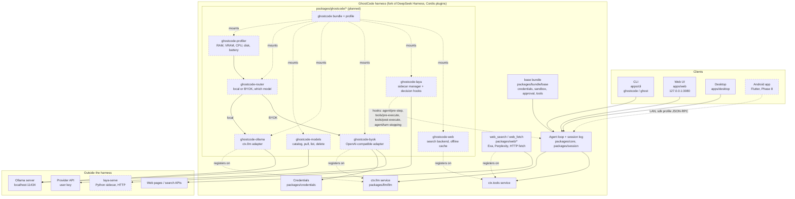
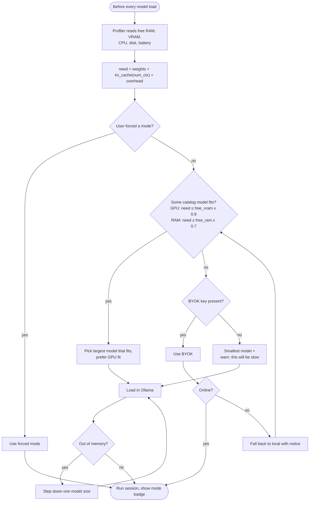
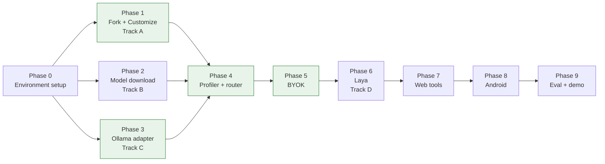

# GhostCode Architecture Diagrams

These diagrams are drawn from `docs/IMPLEMENTATION_PLAN.md` and the current
`harness/` tree. Solid boxes already exist in the fork. Dashed boxes are planned
and do not exist yet (`harness/packages/ghostcode/` has not been created).

## 1. System architecture



## 2. Router decision (Phase 4)



## 3. One agent turn with Laya decisions (Phase 6)

```mermaid
sequenceDiagram
    autonumber
    actor User
    participant Loop as Agent loop
    participant Laya as ghostcode-laya
    participant Sidecar as laya-serve
    participant LLM as ctx.llm (Ollama or BYOK)
    participant Tools as ctx.tools
    participant Log as Session log

    User->>Loop: Request
    Loop->>Laya: agent/pre-step
    Laya->>Sidecar: task type (choice), needs web (noul), too hard (noul)
    Sidecar-->>Laya: scores, about 33 ms
    Note over Laya,Sidecar: Skip decision if no reply in 200 ms
    Laya->>Log: log decision event
    Laya-->>Loop: prompt section, tool subset, maybe suggest BYOK
    Loop->>LLM: agent/request, llm/stream
    LLM-->>Loop: text + tool call
    Loop->>Laya: tools/pre-execute
    Laya->>Sidecar: is this command destructive? (noul)
    alt destructive
        Laya-->>User: ask for approval
    end
    Loop->>Tools: tools/execute
    Tools-->>Loop: result
    Loop->>Laya: tools/post-execute
    Laya->>Sidecar: did it succeed? (noul)
    Laya-->>Loop: retry or continue
    Loop->>Laya: agent/turn-stopping
    Laya->>Sidecar: is the request fully done? (noul)
    Laya->>Log: log decision event
    Laya-->>Loop: stop or continue
    Loop-->>User: Answer
```

## 4. Phase dependencies



Green phases (1, 3, 4, 5) make up the minimum demo from plan section 9.
